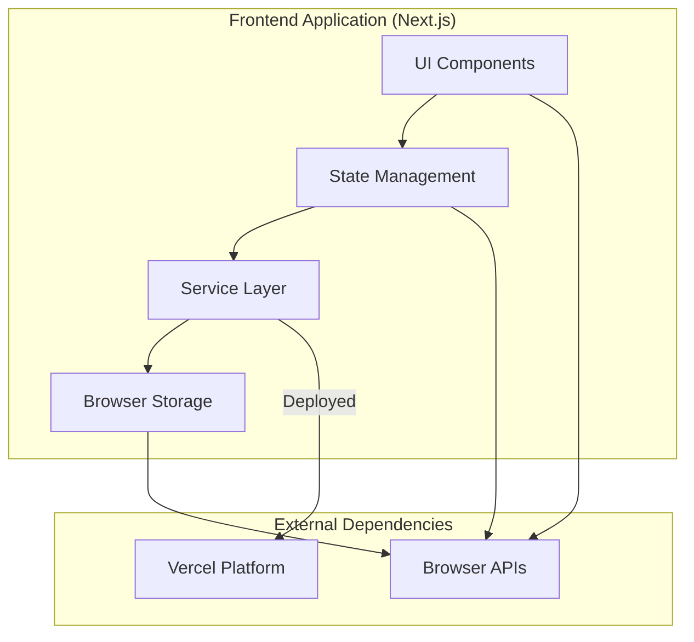
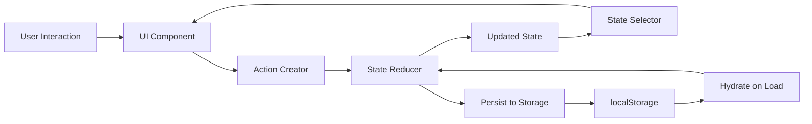

# Design Document: Rummy Scorecard Frontend Application

## Overview

The Rummy Scorecard Frontend Application is a single-page web application designed to track player scores in the card game Rummy. The application enables game hosts to add up to 7 players, record scores per round, and automatically track player elimination when scores reach or exceed 201 points. Built with React and Next.js, the application will be deployed on Vercel with full responsiveness and accessibility compliance.

### Core Capabilities

1. **Player Management**: Add up to 7 players with unique names and identifiers
2. **Score Tracking**: Record scores per round with automatic cumulative calculation
3. **Elimination Detection**: Automatically mark players as eliminated when reaching 201+ points
4. **Round Management**: Organize scores by playing sessions with proper round isolation
5. **Data Persistence**: Maintain game state across browser sessions using localStorage
6. **Responsive Design**: Fully functional on mobile, tablet, and desktop devices

### Design Goals

- **Simplicity**: Intuitive interface requiring minimal explanation
- **Reliability**: Consistent behavior across all browsers and devices
- **Accessibility**: WCAG 2.1 AA compliance for all users
- **Performance**: Fast, responsive interactions with immediate feedback
- **Maintainability**: Clean, well-structured code with clear separation of concerns

## Architecture

### System Architecture Diagram



### Technology Stack

1. **Framework**: Next.js 14 (React 18) with TypeScript
2. **Deployment**: Vercel Platform
3. **Styling**: Tailwind CSS for responsive design
4. **State Management**: React Context API with useReducer
5. **Persistence**: localStorage API with fallback to sessionStorage
6. **Validation**: Zod for schema validation
7. **Testing**: Jest + React Testing Library + Vitest for property-based testing

### Architecture Principles

1. **Component-Based Architecture**: Modular React components with clear responsibilities
2. **Unidirectional Data Flow**: State updates flow through predictable reducers
3. **Separation of Concerns**: UI components separate from business logic and state management
4. **Progressive Enhancement**: Core functionality works without JavaScript, enhanced with it
5. **Graceful Degradation**: Fallback mechanisms for unsupported browser features

## Components and Interfaces

### Core Components

#### 1. App Component (`App.tsx`)
- **Purpose**: Root application component
- **Responsibilities**:
  - Initialize application state
  - Provide context providers
  - Render main layout structure
  - Handle global error boundaries

#### 2. PlayerManagement Component (`PlayerManagement.tsx`)
- **Purpose**: Manage player addition and display
- **Responsibilities**:
  - Render player input form
  - Validate player names (non-empty, unique, length constraints)
  - Display current players list
  - Handle player addition within 7-player limit
- **Props**:
  ```typescript
  interface PlayerManagementProps {
    players: Player[];
    onAddPlayer: (name: string) => void;
    maxPlayers: number;
  }
  ```

#### 3. ScoreEntry Component (`ScoreEntry.tsx`)
- **Purpose**: Enter and display scores per round
- **Responsibilities**:
  - Render score input fields for each active player
  - Validate score inputs (numeric, within reasonable bounds)
  - Update player scores and check for elimination
  - Display current round number
- **Props**:
  ```typescript
  interface ScoreEntryProps {
    players: Player[];
    currentRound: number;
    onScoreSubmit: (playerId: string, score: number) => void;
    onRoundComplete: () => void;
  }
  ```

#### 4. ScoreDisplay Component (`ScoreDisplay.tsx`)
- **Purpose**: Display real-time score updates
- **Responsibilities**:
  - Show player names and current scores
  - Visually distinguish active vs eliminated players
  - Sort players by score (or alphabetically when tied)
  - Highlight elimination threshold (200/201)
- **Props**:
  ```typescript
  interface ScoreDisplayProps {
    players: Player[];
    eliminationThreshold: number;
  }
  ```

#### 5. RoundManager Component (`RoundManager.tsx`)
- **Purpose**: Manage round progression
- **Responsibilities**:
  - Display current round number
  - Provide controls to start new rounds
  - Prevent modification of previous round scores
  - Reset score entry tracking for new rounds
- **Props**:
  ```typescript
  interface RoundManagerProps {
    currentRound: number;
    onNewRound: () => void;
    canStartNewRound: boolean;
  }
  ```

### Service Interfaces

#### 1. Game State Service
```typescript
interface GameStateService {
  // Player operations
  addPlayer(name: string): Player;
  getPlayers(): Player[];
  updatePlayerScore(playerId: string, score: number): Player;
  
  // Round operations
  startNewRound(): void;
  getCurrentRound(): number;
  
  // State persistence
  saveState(): void;
  loadState(): GameState | null;
  clearState(): void;
}
```

#### 2. Validation Service
```typescript
interface ValidationService {
  validatePlayerName(name: string): ValidationResult;
  validateScore(score: number | string): ValidationResult;
  isPlayerEliminated(score: number): boolean;
}
```

#### 3. Storage Service
```typescript
interface StorageService {
  setItem(key: string, value: string): void;
  getItem(key: string): string | null;
  removeItem(key: string): void;
  clear(): void;
  isAvailable(): boolean;
}
```

### Component Hierarchy

```
App
├── Header
├── MainLayout
│   ├── PlayerManagement
│   │   ├── PlayerForm
│   │   └── PlayerList
│   ├── ScoreEntry
│   │   ├── RoundDisplay
│   │   ├── ScoreInputs (per active player)
│   │   └── SubmitControls
│   ├── ScoreDisplay
│   │   ├── PlayerScoreCards
│   │   └── EliminationStatus
│   └── RoundManager
│       ├── RoundCounter
│       └── RoundControls
└── Footer
```

## Data Models

### Core Data Types

#### Player Model
```typescript
interface Player {
  id: string;           // UUID or unique identifier
  name: string;         // Player display name
  totalScore: number;   // Cumulative score across all rounds
  isEliminated: boolean; // Whether player has reached elimination threshold
  createdAt: Date;      // When player was added
  updatedAt: Date;      // Last score update
}

// Player creation DTO
interface CreatePlayerDTO {
  name: string;
}

// Player update DTO  
interface UpdatePlayerDTO {
  playerId: string;
  score: number;        // Score to add for current round
}
```

#### Round Model
```typescript
interface Round {
  id: number;           // Sequential round number (1, 2, 3...)
  scores: RoundScore[]; // Scores recorded in this round
  isComplete: boolean;  // Whether round is finalized
  createdAt: Date;      // When round started
  completedAt?: Date;   // When round was finalized
}

interface RoundScore {
  playerId: string;     // Reference to player
  score: number;        // Score for this round
  recordedAt: Date;     // When score was recorded
}
```

#### Game State Model
```typescript
interface GameState {
  players: Player[];           // All players in the game
  currentRound: number;        // Current round number
  rounds: Round[];             // Historical rounds
  settings: GameSettings;      // Game configuration
  lastUpdated: Date;           // Last state modification
}

interface GameSettings {
  maxPlayers: number;          // Maximum players allowed (7)
  eliminationThreshold: number; // Score threshold for elimination (201)
  maxScorePerEntry: number;    // Reasonable maximum per round (e.g., 100)
  playerNameMaxLength: number; // Maximum display length for names
}
```

### State Management Structure

#### Redux/Context State Shape
```typescript
interface AppState {
  game: GameState;
  ui: UIState;
}

interface UIState {
  isLoading: boolean;
  error: string | null;
  activeView: 'setup' | 'playing' | 'results';
  formValidation: FormValidationState;
}

interface FormValidationState {
  playerName: {
    isValid: boolean;
    message?: string;
  };
  score: {
    isValid: boolean;
    message?: string;
  };
}
```

### Validation Schemas (Zod)

```typescript
import { z } from 'zod';

const PlayerSchema = z.object({
  id: z.string().uuid(),
  name: z.string()
    .min(1, 'Player name is required')
    .max(30, 'Player name must be 30 characters or less'),
  totalScore: z.number().int().min(0),
  isEliminated: z.boolean(),
  createdAt: z.date(),
  updatedAt: z.date(),
});

const ScoreEntrySchema = z.object({
  playerId: z.string().uuid(),
  score: z.number()
    .int('Score must be an integer')
    .min(0, 'Score cannot be negative')
    .max(100, 'Score per round cannot exceed 100'),
});

const GameStateSchema = z.object({
  players: z.array(PlayerSchema).max(7),
  currentRound: z.number().int().min(1),
  rounds: z.array(z.any()), // RoundSchema would be defined similarly
  settings: z.object({
    maxPlayers: z.literal(7),
    eliminationThreshold: z.literal(201),
    maxScorePerEntry: z.number().int().min(1).max(100),
    playerNameMaxLength: z.number().int().min(1).max(50),
  }),
  lastUpdated: z.date(),
});
```

### Local Storage Structure

```typescript
// Storage key
const STORAGE_KEY = 'rummy-scorecard-game-state';

// Serialized format
interface SerializedGameState {
  players: Array<{
    id: string;
    name: string;
    totalScore: number;
    isEliminated: boolean;
    createdAt: string; // ISO string
    updatedAt: string; // ISO string
  }>;
  currentRound: number;
  rounds: Array<{
    id: number;
    scores: Array<{
      playerId: string;
      score: number;
      recordedAt: string;
    }>;
    isComplete: boolean;
    createdAt: string;
    completedAt?: string;
  }>;
  settings: GameSettings;
  lastUpdated: string;
}
```

### Data Flow Diagram



---

## Correctness Properties

*A property is a characteristic or behavior that should hold true across all valid executions of a system—essentially, a formal statement about what the system should do. Properties serve as the bridge between human-readable specifications and machine-verifiable correctness guarantees.*

### Property 1: Player Addition Integrity

*For any* valid player name (non-empty, non-whitespace string), when added to the game, the system SHALL store the name correctly and assign a unique identifier to the player.

**Validates: Requirements 1.2, 1.3, 1.4**

### Property 2: Score Addition Consistency

*For any* active player and any valid numerical score, when the score is added, the player's total score SHALL increase by exactly that amount and the updated total SHALL be immediately displayed.

**Validates: Requirements 2.1, 2.3, 3.1**

### Property 3: Elimination Threshold

*For any* player whose total score reaches or exceeds 201, the system SHALL immediately mark the player as eliminated and prevent any further score entries for that player.

**Validates: Requirements 2.2, 2.5**

### Property 4: Game State Display Completeness

*For any* game state, the system SHALL display all players' names and current total scores, with eliminated players visually distinguished from active players.

**Validates: Requirements 3.2, 3.3**

### Property 5: Round Management Isolation

*For any* game in progress, when a new round is started, score entry tracking SHALL reset for the current round while preserving all previous rounds' scores as read-only.

**Validates: Requirements 4.1, 4.4**

### Property 6: Input Validation

*For any* user input attempt, if the input violates validation rules (empty player name, invalid score format, etc.), the system SHALL prevent the action and display an appropriate validation message.

**Validates: Requirements 6.4, 6.5, 6.6**

### Property 7: Player Limit Enforcement

*For any* game state with 7 players already added, attempting to add an 8th player SHALL be rejected with appropriate feedback.

**Validates: Requirements 1.1**

### Property 8: Score Sorting Consistency

*For any* set of players with identical total scores, the system SHALL display them consistently according to a deterministic ordering rule (either addition order or alphabetical by name).

**Validates: Requirements 3.4**

### Property 9: Round Number Accuracy

*For any* game progression through multiple rounds, the displayed round number SHALL always match the current round being scored.

**Validates: Requirements 4.3**

### Property 10: Display Length Handling

*For any* player name that exceeds maximum display length, the system SHALL handle it appropriately through truncation or wrapping without losing data integrity.

**Validates: Requirements 1.5**

## Error Handling

### Validation Errors
1. **Empty Player Name**: Display "Player name cannot be empty" message
2. **Invalid Score Format**: Display "Please enter a valid number" message  
3. **Score for Eliminated Player**: Display "This player is eliminated and cannot receive scores" message
4. **Maximum Players Exceeded**: Display "Maximum 7 players allowed" message
5. **Modify Previous Round**: Display "Previous round scores cannot be modified" message

### System Errors
1. **Local Storage Unavailable**: Gracefully initialize with empty game state, notify user "Game data will not be saved between sessions"
2. **Corrupted Game State**: Attempt recovery, fall back to new game if unrecoverable
3. **Network Issues (future)**: For potential online features, implement offline mode with sync on reconnect

### User Experience Errors
1. **Invalid Input Feedback**: Clear, contextual error messages near the input field
2. **Action Prevention**: Disable buttons/inputs when actions are invalid
3. **State Confirmation**: Visual confirmation for successful actions (player added, score recorded)

### Error Recovery Strategies
1. **Auto-save**: Regular saves to prevent data loss
2. **Undo/Redo**: Basic history tracking for user actions
3. **Export/Import**: Allow manual backup of game state
4. **Session Recovery**: Attempt to restore last known good state on page load

## Testing Strategy

### Dual Testing Approach
- **Unit Tests**: Verify specific examples, edge cases, and error conditions
- **Property Tests**: Verify universal properties across all inputs using property-based testing
- **Integration Tests**: Verify browser storage, deployment, and accessibility features

### Property-Based Testing Configuration
- **Library**: Use `fast-check` for property-based testing in JavaScript/TypeScript
- **Iterations**: Minimum 100 iterations per property test
- **Tagging**: Each test tagged with design property reference
- **Configuration**:
  ```javascript
  // Example property test configuration
  const propertyConfig = {
    numRuns: 100,
    seed: Date.now(), // Random seed for reproducibility
    path: 'rummy-scorecard-vercel-app'
  };
  ```

### Test Categories

#### 1. Core Logic Tests (Property-Based)
- **Score calculation properties**: Validate Property 2, 3
- **Player management properties**: Validate Property 1, 7  
- **Validation properties**: Validate Property 6
- **Round management properties**: Validate Property 5, 9

#### 2. UI/Component Tests (Example-Based)
- **Component rendering**: Verify all UI components render correctly
- **User interaction**: Test button clicks, form submissions
- **Responsive design**: Test different screen sizes
- **Accessibility**: Keyboard navigation, screen reader compatibility

#### 3. Integration Tests
- **Local storage**: Data persistence across refresh
- **Deployment**: Build and deploy to Vercel
- **Cross-browser**: Test on major browsers
- **Progressive enhancement**: Functionality with JS disabled

#### 4. Performance Tests
- **State updates**: UI responsiveness during rapid score entry
- **Storage operations**: Performance with large game history
- **Memory usage**: Monitor for memory leaks during long sessions

### Test Implementation Strategy

#### Property Test Implementation Example
```typescript
import { fc } from 'fast-check';

// Property 2: Score Addition Consistency
describe('Score Addition Property', () => {
  it('should correctly add scores to player totals', () => {
    fc.assert(
      fc.property(
        fc.integer({ min: 0, max: 100 }), // Existing score
        fc.integer({ min: -50, max: 100 }) // Score to add
      ),
      (existingScore, scoreToAdd) => {
        const player = createPlayerWithScore(existingScore);
        const updatedPlayer = addScore(player, scoreToAdd);
        
        // Property: New total = old total + added score
        expect(updatedPlayer.totalScore).toBe(existingScore + scoreToAdd);
        
        // Property: Player not eliminated unless total >= 201
        const shouldBeEliminated = updatedPlayer.totalScore >= 201;
        expect(updatedPlayer.isEliminated).toBe(shouldBeEliminated);
      }
    );
  });
});
```

#### Unit Test Coverage Targets
- **Business logic**: 95% coverage
- **Component logic**: 85% coverage  
- **Utility functions**: 90% coverage
- **Error handling**: 100% coverage for defined error cases

#### Integration Test Coverage
- **Critical user journeys**: 100% coverage
- **Data persistence**: All storage operations
- **Accessibility**: WCAG 2.1 AA compliance checks

### Test Environment
- **Development**: Jest with fast-check for property testing
- **CI/CD**: Automated tests on Vercel deployment pipeline
- **Cross-browser**: BrowserStack or similar for compatibility testing
- **Accessibility**: axe-core for automated accessibility testing

### Testing Tools
1. **Jest**: Test runner and assertion library
2. **fast-check**: Property-based testing
3. **Testing Library**: React component testing
4. **axe-core**: Accessibility testing
5. **Cypress**: End-to-end testing (future)
6. **Lighthouse**: Performance and accessibility audits